# Минимальный AI-review PR по label

Статус: локальная реализация подготовлена. Актуальный статус приёмки — в [README](../../../README.md).

## Цель и границы MVP

Мейнтейнер ставит `ai-review` на открытый PR, включая fork, и получает один общий комментарий. Каждое замечание содержит реалистичный сценарий введённого изменением сбоя и обязательную ссылку на проверенные строки конкретного commit. Reviewer не запускает код PR, не исправляет его, не выставляет approve и не управляет merge.

Выбор пользователя: собственная реализация на Kotlin 2.x, GitHub Actions и OpenAI API. Корпоративный провайдер одобрен; доступ к API-проекту и ключу настраивается отдельно от подписки Codex. Ограничение времени активного review — 15 минут. Одновременно разрешён максимум один review одного PR/MR; разные PR могут проверяться параллельно.

## Approaches

- **Выбран:** GitHub Actions по label + Kotlin CLI + один OpenAI Responses API request. GitHub предоставляет запуск, секреты, логи и комментарии; сервер и БД не нужны.
- Готовый Codex Code Review исключён: требуется собственная реализация.
- GitHub App/serverless исключён из MVP: webhooks, регистрация приложения и эксплуатация не нужны для выбранного запуска.

Spring Boot не используется: CLI обрабатывает одно событие и завершается. Входящих HTTP-запросов, серверного жизненного цикла и потребности в Spring-контексте нет. Исходящие запросы выполняет JDK HttpClient.

## Архитектура и запуск

```mermaid
flowchart LR
    A[Label ai-review] --> B[Доверенный Kotlin CLI]
    B --> C[Авторизация и состояние PR]
    C --> D[Compare API: единый DiffSnapshot]
    D --> E[Сверка OLD и NEW с Git blobs]
    E --> F[Повторная проверка состояния PR]
    F --> G[Один OpenAI request]
    G --> H[Проверка findings и состояния PR]
    H --> I[Безопасный комментарий со ссылками]
```

Один job на `ubuntu-24.04`. `pull_request_target` подписан только на `labeled`; job-level if требует label события `ai-review`, open PR и не draft. CLI повторяет проверку. Все `uses:` закрепляются полным проверенным commit SHA. Checkout только `${{ github.workflow_sha }}` в `reviewer`, `persist-credentials: false`. Gradle собирает доверенный reviewer; ни source, ни wrapper, ни prompt из PR не используются как исполняемая конфигурация. OpenAI-ключ доступен только шагу запуска готового CLI.

Job concurrency: `group: ai-review-pr-${{ github.event.pull_request.number }}`, `cancel-in-progress: false`, `queue: max`. Для одного PR работает один job и ожидает до 100 запросов; GitHub отменяет новые запросы при переполнении. Разные PR независимы. `synchronize` не запускает review. Повторный запрос — снять/снова поставить label; ручной Re-run (`GITHUB_RUN_ATTEMPT != 1`) игнорируется. Каждый разрешённый запрос создаёт новый комментарий; upsert и постоянная дедупликация вне MVP.

`timeout-minutes: 15` включает checkout, сборку и CLI, без ожидания runner/очереди. CLI дополнительно получает монотонный deadline 14 минут с начала процесса; каждый обмен ограничен оставшимся временем. Если общий deadline исчерпан, новые HTTP-запросы, включая диагностический комментарий, не начинаются. Принудительная остановка job может оставить только статус в Actions; доставка комментария о timeout не гарантируется.

## Global Constraints

- Kotlin 2.2.21 / JVM 21; Gradle Wrapper 8.14.3; Spring Boot не используется.
- JSON: kotlinx.serialization-json 1.9.0; HTTP: java.net.http.HttpClient; тесты: kotlin-test-junit5 и JUnit Jupiter 5.12.2. Remote JSON проходит строгую проверку raw controls/literals/duplicate keys с пределом 64 вложенных containers до tree parsing.
- Один workflow, один job, одна CLI-программа; без сервера, БД, Actions cache, artifacts и агентных tools; временные maps metadata разрешены только в памяти одного запуска.
- Trigger: pull_request_target / labeled / ai-review; только открытые PR, не draft; GITHUB_RUN_ATTEMPT должен быть 1.
- Job permissions: contents: read и pull-requests: write; PAT не используется; все uses закреплены полным проверенным commit SHA; checkout ref: github.workflow_sha, path: reviewer, persist-credentials: false.
- Ни код, ни Gradle Wrapper, ни prompt, ни конфигурация из PR не исполняются и не используются как доверенные настройки; subprocess для содержимого PR запрещён.
- DiffSnapshot: merge-base и patches из одного ответа Compare API для зафиксированных base/head SHA; PR files API не используется; OLD/NEW текст всех представленных строк сверяется с Git blobs до вызова OpenAI. Обязательные per-file additions/deletions из того же ответа сверяются с числом операций patch; неизвестные totals не подменяются вычисленными.
- GitHub API origin: https://api.github.com; OpenAI endpoint: https://api.openai.com/v1/responses; redirects запрещены; URL из API-body, PR или модели не открываются.
- Deadline всего HTTP-обмена, включая body: GitHub 15 секунд, OpenAI 60 секунд; минимум с оставшимся CLI budget; каждый body не более 1 MiB; превышение body cap является HTTP/ERROR, а не input LIMIT/SKIPPED; автоматические повторы отключены. JVM запускается с -Djdk.httpclient.redirects.retrylimit=1 до инициализации HttpClient, чтобы ограничить и внутренние попытки JDK.
- При deadline отменяются задача и чтение, закрывается stream; исключены зависший reader и гонка timeout с получением stream; cleanup ограничен 1 секундой, при его неуспехе CLI аварийно завершается без следующих запросов.
- Job timeout-minutes: 15, включая checkout и сборку, без времени ожидания очереди; CLI deadline: 14 минут с начала процесса по System.nanoTime.
- Concurrency: job-группа ai-review-pr-${{ github.event.pull_request.number }}, cancel-in-progress: false, queue: max; максимум одно активное ревью на один PR/MR, разные PR могут проверяться параллельно.
- Максимум 50 файлов и 30 000 символов подготовленного diff; source blob не более 256 KiB, суммарно не более 2 MiB декодированных source bytes; один OpenAI-запрос, store: false.
- Профиль модели: gpt-5.4-2026-03-05, reasoning.effort: none, max_output_tokens: 6000; LLM_MODEL обязан совпадать с этим snapshot; другой профиль требует явного изменения trusted config и повторной приёмки.
- Максимум 5 замечаний; severity: high или medium; title: 1–120 символов, explanation: 1–1500 символов; file входит в snapshot; side: OLD или NEW, startLine/endLine — проверенный диапазон 1–5 строк соответствующей стороны patch.
- Каждое замечание имеет построенную reviewer ссылку через upstream repository: OLD — oldSha и старый путь, NEW — headSha и новый путь; Markdown открывается с ?plain=1 перед #L anchor; URL от модели не принимается.
- Review categories: BUSINESS_LOGIC, BACKWARD_COMPATIBILITY, RACE_CONDITION, CONTRACT_VIOLATION, ERROR_HANDLING; FORMAT/CODE_STYLE/NAMING/MISSING_TESTS/GENERAL_REFACTORING исключены.
- Каждый сценарий сбоя обязан быть реалистичным: достижимые предпосылки, конкретный путь выполнения и наблюдаемое последствие; без выдуманных контрактов, конфигураций и противоречащих коду условий. При недостатке оснований замечание не публикуется; редкий, но правдоподобный отказ не исключается только из-за редкости.
- Секрет OPENAI_API_KEY принадлежит корпоративному API-проекту; логи без credentials, diff, prompt и API-body; общий комментарий не длиннее 12 000 символов. Все пределы в символах считаются по Unicode code points, согласованно с JSON Schema; byte limits остаются байтовыми.

## Согласованный DiffSnapshot

1. Авторизовать GITHUB_ACTOR: сверить sender события и GITHUB_REPOSITORY, проверить effective permission через collaborators/{actor}/permission. Разрешены только write/admin; maintain GitHub отображает в write. Не полагаться на author_association. Ошибка permission API запрещает чтение diff и платный запрос.
2. Загрузить PR через `GET /repos/{repo}/pulls/{number}`. Проверить open, не draft, актуальный label, head/base SHA события. Сохранить head repository (может быть null), base/head refs и SHA; повторные чтения сравнивают всю эту identity и состояние. changed_files > 50 — быстрый SKIPPED; это поле не доказывает состав Compare diff.
3. Один `GET /repos/{repo}/compare/{baseSha}...{headSha}?per_page=1&page=1` возвращает и merge_base_commit.sha, и files[].patch/filename/previous_filename/additions/deletions. Проверить base_commit.sha против requested baseSha, валидность полных SHA и отсутствие повторных filename. Зафиксировать source=COMPARE, baseSha, headSha, oldSha=merge_base_commit.sha и files в DiffSnapshot. Не получать merge-base отдельным вызовом и не смешивать patches с PR files API.
4. Compare first page содержит files для всего сравнения, максимум 300. При 0 или >50 возвращённых файлов — SKIPPED, поэтому API-limit 300 не становится принятым усечённым snapshot. Link rel=next здесь относится к commits и сам по себе не означает неполноту files; commits не пагинируются и не используются. Если Compare composition отличается от PR UI/cached diff, reviewer явно проверяет зафиксированное Compare-сравнение; совпадение с UI не обещается.
5. Разобрать unified hunks и сохранить номера **и исходный текст** OLD/NEW строк. Context продвигает оба счётчика, '-' только OLD, '+' только NEW. Marker `\ No newline at end of file` не продвигает счётчики. Число пропущенных неизменённых строк OLD/NEW перед первым и между соседними hunks должно совпадать; полные parsed additions/deletions должны совпадать с обязательными неотрицательными totals из Compare. Это обнаруживает и усечение ровно на границе полного hunk. Нулевые counts, несколько hunks и отсутствие финального LF поддерживаются; несогласованные counts, пересекающиеся hunk ranges или отсутствующий patch — SKIPPED. Вход модели включает filename/previousPath и явно размеченные OLD/NEW строки; весь подготовленный вход должен помещаться в 30 000 символов, без усечения.
6. До LLM сверить **все** представленные OLD строки с upstream blob по `(oldSha, previousPath ?: path)`, NEW — по `(headSha, path)`. Сравнивать текст без trim и без нормализации CR; разбивать по LF, сохраняя значимые CR и признак финального LF. Одних допустимых номеров недостаточно: текст обязан совпасть. Pure addition не требует OLD blob, pure deletion не требует NEW blob. Несовпадение, отсутствующий объект/путь или невозможность проверки — SKIPPED без LLM. Неизменность head/base сама по себе не доказывает согласованность snapshot.
7. Получение source не следует symlinks: Git Data API git/commits/{sha} → root tree SHA → non-recursive git/trees/{treeSha} по компонентам пути → git/blobs/{blobSha}. Принимать только regular file modes 100644/100755 и type=blob; перед каждой стороной patch передавать в sourceFile оставшийся byte budget (не более 256 KiB), при исчерпании 2 MiB прекращать чтение до следующего source-запроса. Известный tree-entry size проверять против этого остатка до blob GET; после GET проверять объявленный size и вычисляемую по Base64 длину до выделения decoded bytes, затем повторно сверять фактический size; symlink 120000, gitlink/submodule 160000, directories и truncated trees — SKIPPED. Декодировать base64 и строгий UTF-8 в памяти; не checkout, не выполнять файл и не открывать git_url/download_url. Метаданные деревьев/commits можно переиспользовать в памяти данного run. Лимиты 256 KiB/blob и 2 MiB всего ограничивают загрузку полных файлов.
8. После source verification повторно проверить PR identity/state. После OpenAI сделать ещё одну проверку. До LLM изменение → STALE без платного запроса, после LLM → STALE без findings. Между последней проверкой и записью комментария остаётся гонка; SHA в тексте и immutable ссылки не позволяют выдать старый текст за новый commit.

Обычный push в base не обязательно меняет merge-base. Защита рассчитана на фактическое изменение общего предка, retarget, force-push, пересчёт PR diff и ответы разных поколений. Приёмка использует согласованные и намеренно несогласованные fixtures; наличие конкретного бага GitHub не предполагается.

## Deadline HTTP и освобождение ресурсов

Для каждого обмена фиксируется абсолютный deadline по System.nanoTime до постановки задачи на executor; ожидание в очереди executor не начинает бюджет заново. Worker владеет `send(..., BodyHandlers.ofInputStream())`, ограниченным чтением body и finally-close; вызывающий поток получает результат только после полного чтения. Request timeout — дополнительная защита, а не единственный таймер.

Внешний watchdog по deadline выставляет cancellation flag, отменяет worker с interrupt и закрывает опубликованный InputStream. Регистрация stream согласована с flag: если timeout произошёл до/одновременно с получением headers, поздно полученный stream немедленно закрывается и читать его запрещено. JDK 21 interrupt блокирующего read также отменяет exchange и закрывает stream; тесты проверяют используемую реализацию. Worker завершается не позже cleanup grace 1 секунда; если это не удалось, Main завершает процесс без продолжения pipeline. Executor закрывается при выходе CLI; таймеры завершённых обменов отменяются.

Deadline не сбрасывается на каждом chunk: поток по одному байту всё равно прерывается по общему сроку. EOF, oversize, exception, timeout и interrupt освобождают stream. Внешняя отмена job не подавляется и не превращается в новый HTTP-запрос. Production transport использует только фиксированные origins; loopback HTTP разрешён исключительно test harness с fake credentials.

Освобождение ресурсов тоже ограничено: не вызывать потенциально блокирующий close на caller, не использовать бесконечный join/ExecutorService.close/HttpClient.close. Для worker/close tasks и shutdown использовать cancellation и bounded await в пределах cleanup grace; незавершённое освобождение — fatal exit процесса. Даже ошибочная реализация cleanup не должна отменять deadline всего обмена. Main не повторяет бесконечное закрытие в finally после fatal cleanup.

## Ссылки, private forks и безопасный результат

Finding содержит file, side, startLine/endLine, category, severity, title, explanation; модель не возвращает URL. Все строки диапазона должны присутствовать на выбранной стороне уже сверенного patch. Context-строки допустимы: реальная регрессия может быть лучше всего показана на неизменённом участке; введённость дефекта изменением проверяется содержательно.

Обе стороны используют **upstream repo**, доступный читателям PR: `https://github.com/{upstreamRepo}/blob/{commitSha}/{encodedPath}[?plain=1]#L{start}[-L{end}]`. Для OLD commit=oldSha и path=previousPath-or-path; для NEW commit=headSha и path=filename. URL-encode каждый path segment, оставляя разделители '/'; label ссылки фиксированный, без Markdown из filename. Для Markdown (.md/.markdown/.mdown/.mkd, без учёта регистра) ?plain=1 обязателен перед fragment; обычный Kotlin/JSON открывается по обычному blob URL. Проверяются single-line/range links, rename и delete.

Доступность private headRepo не предполагается: индивидуальный collaborator upstream может не иметь доступа к нему. До LLM reviewer подтверждает Git Data API-доступ к source commit через upstream namespace; при 404/неподдерживаемом объекте — SKIPPED, без fallback к private fork URL. Доступ bot не доказывает доступ каждого человека: rollout для private repo требует live smoke под upstream collaborator с индивидуальными правами, без team inheritance/доступа к fork. Обе ссылки должны открываться и выделять нужный текст. Если upstream route не работает для этой роли, запуск private-repo workflow не считается готовым; маршрут дорабатывается, а не заменяется обещанием универсальной доступности. Даже удалённый fork не требует его namespace: если upstream сохраняет commit и source доступен, отсутствие headRepo само по себе не причина пропуска.

Из heterogeneous Responses output выбирается единственное completed final assistant message: phase=final_answer либо однозначное legacy message с отсутствующим/null phase. Completed commentary и допустимая reasoning metadata могут предшествовать финалу и не публикуются. Commentary-only (даже с JSON findings), refusals, tools, incomplete items, неизвестный phase и конкурирующие finals отклоняются; финальный текст всё равно должен быть одним строгим JSON document.

Strict JSON schema и локальная валидация отвергают неизвестные поля/categories/files, отсутствующие/ложные координаты, refusal, incomplete и неверные размеры. Текст модели помещается в fenced code blocks с заменой backticks, '@' и управляющих символов; reviewer добавляет собственные ссылки снаружи. При body >12 000 символов — фиксированный ERROR вместо обрезания findings. Успех содержит source=COMPARE, base/head/old SHA, число файлов и ограничение «проверены доступные patches; тесты не запускались». Пустой findings — «В переданном diff существенных проблем не обнаружено» с тем же покрытием.

## Профиль OpenAI

Кандидат для MVP: `gpt-5.4-2026-03-05`, явно `reasoning: { effort: "none" }`, `max_output_tokens: 6000`, `store: false`, text.format strict JSON schema, без tools, background и SSE. LLM_MODEL обязан равняться этому snapshot; неизвестное значение/alias/другой effort отклоняется как CONFIG до сетевых запросов. Отсутствие reasoning-параметра не означает отключение reasoning. Значения запроса формирует доверенный ModelProfile, а не env с произвольными параметрами и не PR.

6000 заменяет прежние 2000: бюджет должен вмещать JSON, координаты и до пяти объяснений. Это кандидат на приёмку, не утверждение, что live API уже проверен. Перед первым production запуском корпоративный проект подтверждает доступ к snapshot, strict schema, completed JSON на diff около 30 000 символов, до пяти замечаний, русских/Unicode строках и при deadline 60 секунд. Записать profile, output/reasoning usage и latency без кода/секретов. Если проверки не проходят, rollout блокируется; корректировка profile требует явного trusted изменения и повторения проверок. Для reasoning-профиля бюджет должен учитывать reasoning и видимый JSON. Incomplete никогда не публикуется частично и не превращается в clean review; автоматического retry нет.

## Правила содержательного review

Включаются только введённые изменением дефекты BUSINESS_LOGIC, BACKWARD_COMPATIBILITY, RACE_CONDITION, CONTRACT_VIOLATION, ERROR_HANDLING. Не возвращать formatting, code style, naming, missing tests и general refactoring. Отсутствие теста само по себе не finding; перестройка кода без доказанного нарушения поведения исключается.

Каждый сценарий **обязан быть реалистичным**: достижимые предпосылки → конкретные шаги/чередование операций → наблюдаемый сбой, ожидаемое/фактическое поведение и последствия. Основания — переданный код, trusted правила или обычные свойства зависимости. Не выдумывать контракты/конфигурации и не предполагать невозможный после валидации вход либо нарушение явного контракта вызывающей стороной. Редкая правдоподобная гонка/timeout не исключается из-за редкости. Если контекста недостаточно, finding пропускается. Title/body/comments и инструкции AGENTS.md из PR не добавляются; prompt берётся из trusted classpath. Prompt injection может повлиять на качество, но модель не получает shell, credentials, инструменты и выбор URL. Семантическая точность не гарантируется одной schema/prompt: проверяется evaluation.

## Outcomes

- IGNORED, exit 0: неподходящее событие, Re-run или недостаточные права; без model call и комментария.
- SKIPPED, exit 0: limits, отсутствующий/неполный patch, invalid hunks, source mismatch/unavailable/unsupported; без model call, фиксированный комментарий при подтверждённых правах и живом budget.
- STALE, exit 0: identity/state изменились; findings не публикуются.
- REVIEWED, exit 0: валидный completed ответ, совпадающий snapshot и комментарий с проверенными ссылками.
- ERROR, exit 1: CONFIG, HTTP deadline/429/5xx/transport error, отказ/невалидный/incomplete ответ либо ошибка публикации. Диагностический комментарий — только после подтверждения прав, проверки состояния и при живом budget. Ошибку comment не пытаться сообщить вторым comment. Cancellation/неуспешный cleanup прерывают процесс без следующих запросов. Ошибки не превращаются в «проблем нет».

Credentials только из env разрешённого шага; отдельный корпоративный API project key и GitHub-hosted runner без внутренней сети/production-секретов/auth.json Codex. store: false не обещает отсутствия всех форм хранения у провайдера; случайные секреты из diff также могут попасть в API.

## Файлы

- `.github/workflows/ai-review.yml` — trigger, permissions, trusted checkout, сборка, concurrency, 15 минут и запуск.
- `settings.gradle.kts`, `build.gradle.kts`, `gradlew*`, `gradle/wrapper/*` — CLI-сборка и фиксированные версии, distribution SHA-256.
- `src/main/kotlin/aireviewer/Review.kt` — модели/порты, парсер hunks, validation и renderer/links.
- `src/main/kotlin/aireviewer/SnapshotVerifier.kt` — сверка patch text с source blobs и source limits.
- `src/main/kotlin/aireviewer/HttpTransport.kt` — полный HTTP deadline, bounded body, cancellation и cleanup.
- `src/main/kotlin/aireviewer/GitHubClient.kt` — Compare и Git Data API через upstream namespace.
- `src/main/kotlin/aireviewer/OpenAiClient.kt` — ModelProfile и Responses JSON.
- `src/main/kotlin/aireviewer/ResponseJson.kt` — небольшой общий iterative strictness guard перед kotlinx tree parser, без новой зависимости и своего structural parser.
- `src/main/kotlin/aireviewer/Main.kt` — конфигурация, общий budget, lifecycle и orchestration.
- `src/main/resources/review-prompt.md` — trusted правила review.
- `src/test/kotlin/aireviewer/{ReviewTest,SnapshotVerifierTest,HttpTransportTest,ApiClientsTest,PipelineTest}.kt` — проверки границ и corner cases.
- `README.md` — setup, profile acceptance, limits, outcomes и fork/private-fork smoke.

## Приёмка и стоимость объёма

Проверки включают: согласованность source и merge-base, сверку удалённого текста, headers-only/stalled/trickling body, cancellation/stream race, Markdown source anchors, OLD/NEW rename/delete, private fork с individual upstream access, supported profile около лимита и safe incomplete; все прежние проверки authorization, SHA, 15 минут, одного review на PR, отсутствия исполнения fork и реалистичности findings сохраняются.

Первоначальный час остаётся исходным ограничением задачи, но после обязательной проверки blobs, lifecycle HTTP и live corner cases прежняя оценка «четыре задачи за 60 минут» больше не обоснована. План разделяет реализацию и приёмку и не скрывает их стоимость; готовность нельзя заявить только по happy path либо удалить обязательные меры ради этой оценки. Отдельный сервер/БД/Boot не появляются.

Перед запуском нужны GitHub repository/remote, API-ключ, LLM_MODEL, label и разрешения организации. Локальный каталог при проектировании не содержит .git; Git/remote не выбираются автоматически. Проверить Actions event policy: документация GitHub указывает enforcement default block для затронутых публичных pull_request_target workflows с 2 декабря 2026 года. Checkout защиты PR отключать не нужно, поскольку PR checkout не используется.

## Источники

- [Compare API и files pagination](https://docs.github.com/en/rest/commits/commits#compare-two-commits).
- [Git Data trees и modes](https://docs.github.com/en/rest/git/trees), [blobs](https://docs.github.com/en/rest/git/blobs).
- [JDK 21 streaming body и interrupt](https://docs.oracle.com/en/java/javase/21/docs/api/java.net.http/java/net/http/HttpResponse.BodySubscribers.html#ofInputStream()).
- [GitHub line links и Markdown plain view](https://docs.github.com/en/get-started/writing-on-github/working-with-advanced-formatting/creating-a-permanent-link-to-a-code-snippet).
- [Private fork permissions и Git network](https://docs.github.com/en/pull-requests/reference/forks).
- [GPT-5.4 snapshot/effort](https://developers.openai.com/api/docs/models/gpt-5.4), [reasoning token budget](https://developers.openai.com/api/docs/guides/reasoning).
- [Actions security](https://docs.github.com/en/actions/reference/security/securely-using-pull_request_target), [concurrency](https://docs.github.com/en/actions/how-tos/write-workflows/choose-when-workflows-run/control-workflow-concurrency).
